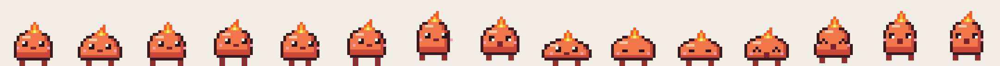
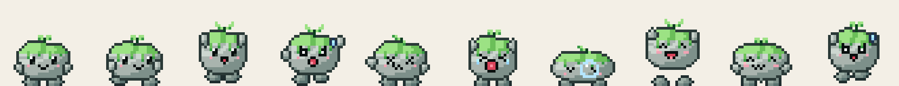
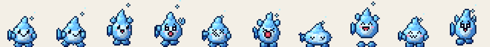

# Gremlets

Tiny elemental pixel creatures that live on your Mac desktop. They walk along the Dock line, hop up onto your
app windows, ride along when you drag a window, tumble off when you close it, nap when they're tired, and
show a heart when you pet them.

> 🎥 _Demo GIF coming soon (recorded on a real desktop)._





| Species | Element | Personality |
|---|---|---|
| **Kindlet** | ember | Curious and bouncy, with a little flame that flickers when it's happy |
| **Mossling** | moss | Slow, sleepy pebble with a sprout on its head |
| **Dropple** | tide | Quick, springy water drop and the best jumper of the three |

All creatures, names and art are original.

## Features

- **Click-through overlay.** Transparent, borderless, always-on-top panels on every screen. Clicks pass straight
  through to your apps except on a creature's opaque pixels (per-pixel hit testing).
- **Window surfaces.** Creatures stand and walk on the top edges of real app windows, ride along when a
  window moves, and fall when it closes, minimizes or gets covered.
- **Physics.** Gravity, one-way platforms, wall bounces, and drag-and-throw using the cursor's release velocity.
- **Behavior AI.** A utility-scored brain picks between idle, walk, hop, jump-to-window, chase-the-cursor and
  sleep, based on energy and surroundings.
- **Multi-monitor and Spaces.** One overlay per screen, creatures can walk across touching monitors, and the
  overlay follows you onto every Space and over full-screen apps.
- **Menu bar app.** Add or send home gremlets, pause, launch at login, and open the custom sprites folder.
- **Bring your own art.** The app loads Aseprite JSON exports directly (see below).
- **Low CPU.** About 1.6–2% CPU with three creatures moving on an Apple Silicon MacBook (see Performance).

## Run it

Requires macOS 13+ and Swift 5.9+ (Xcode or just the Command Line Tools).

```bash
swift run Gremlets                                  # dev run
swift run Gremlets --spawn kindlet,mossling,dropple # pick who shows up
scripts/bundle.sh && open build/Gremlets.app        # real app bundle (needed for Launch at Login)
swift test                                          # engine tests
```

No permissions are required: window *positions* are readable without Screen Recording access (only window
titles need it, and Gremlets never reads them).

## Drawing your own Gremlets

1. In Aseprite, draw your frames (any size; 24×24 matches the built-ins) and add **tags** named
   `idle`, `walk`, `jump`, `fall`, `land`, `sleep`, `react`, `drag`. Only `idle` is required; missing ones
   fall back sensibly. Draw the creature **facing right** with its feet on the bottom row.
2. **File → Export Sprite Sheet**: Layout *Horizontal Strip*, Output ✔ JSON Data (Array or Hash), ✔ Tags.
   Name them `sheet.png` and `sheet.json`.
3. Put both in `~/Library/Application Support/Gremlets/Species/<your-id>/` (menu bar → *Open Custom Sprites Folder…*).
4. Optional `species.json`:
   ```json
   { "name": "Glimmet", "element": "spark", "scale": 3, "walkSpeed": 70, "jumpPower": 1.0, "sleepiness": 1.0 }
   ```
5. Restart Gremlets. A folder with the same id as a built-in species replaces it.

The built-in placeholders are generated by `swift run spritegen` (procedural pixel art in
`Sources/spritegen/main.swift`), which writes this same format.

## Architecture

```
Sources/
  GremletsCore/     platform-agnostic engine (no AppKit), unit tested
    World.swift       simulation: physics, grounding, window riding, input (drag/throw/poke/pet)
    Brain.swift       utility AI: scores candidate actions and picks one by weighted random choice
    Surfaces.swift    turns screens + windows into one-way platforms, with occlusion
    Creature.swift    state (activity, energy, facing), per-pixel hit testing
    Species.swift     animation timing + alpha masks, decoupled from any image type
  Gremlets/         macOS front end
    Overlay.swift     click-through NSPanels, CALayer rendering, mouse input, particles
    WindowTracker.swift  CGWindowList → window frames (y-flipped into Cocoa space)
    SpriteLibrary.swift  Aseprite JSON loader + alpha masks
    App.swift         adaptive game loop, menu bar, roster persistence, perf monitor
  spritegen/        procedural generator for the placeholder species
```

Details and design decisions: [docs/ARCHITECTURE.md](docs/ARCHITECTURE.md).

## Performance

Measured with `GREMLETS_PERF=1` (prints process CPU% every 10 s from `getrusage`), release build,
MacBook (Apple Silicon), macOS 15:

| Scenario | CPU |
|---|---|
| 3 creatures walking/jumping (30 Hz loop, 10 Hz window polling) | 1.6–2.0% |

How it stays cheap:
- The loop rate adapts: 60 Hz only while something is airborne or being dragged, 30 Hz while walking, 8 Hz when everyone is idle or asleep.
- Window polling (the most expensive call) runs at 4–10 Hz and only jumps to 60 Hz while a window that a creature is standing on is moving.
- Sprite layers only get new `contents` when the animation frame actually changes. Hearts and Zzz particles are pure Core Animation, so they cost no per-frame CPU.
- Timer tolerance lets macOS coalesce wakeups.

## Roadmap

- [ ] Creatures notice each other (follow, play, bump)
- [ ] Peek around screen edges
- [ ] Demo GIF + signed/notarized download
- [ ] Windows port of the platform layer (the engine is already platform-independent)
