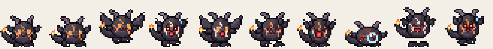

# Gremlets

Fifty one-of-a-kind pixel creatures (animals, bugs, dragons, dinosaurs and mythical beasts) that live on
your Mac desktop. They walk along the Dock line, hop and fly up onto your app windows, ride along when you
drag a window, tumble off when you close it, play tag with each other, nap in piles, stand on each other's
heads, throw dance parties, and show off a signature move.

> 🎥 _Demo GIF coming soon (recorded on a real desktop)._


| Family | Count | Some of them |
|---|---|---|
| Animals | 16 | Flurrie the scarf bunny, Dandelet the dandelion lion cub, Yuzubara the hot-spring capybara, Pomble the tanuki |
| Insects & Bugs | 12 | Spotsy the ladybug, Zipwing the dragonfly, Bumbuzz the bumblebee, Orchis the orchid mantis, Peacockle the dancing spider |
| Dragons | 6 | Smolder the charcoal dragonling, Steepy the teacup dragon, Kumoryu the cloud dragon |
| Dinosaurs | 7 | Trikit, Rexlet, Brontle, Bonkle the head-bonker |
| Mythical | 9 | Kindlet the candle spirit, Griffet the griffin chick, Tripup the three-headed puppy, Inklet the baby kraken |

Full catalog with personalities and signature moves: [docs/SPECIES.md](docs/SPECIES.md).

Every creature has 20 animations (83 frames): idle, look-around, walk, run, crouch, jump, fly, a panicked fall,
a squash landing, dizzy, a big yawn, sleep with a snot bubble, a startled wake-up, a happy jump, petting bliss,
dance, wave, dangling when dragged, an "!" alert, and its signature move.



All creatures, names and art are original. The design approach borrows *principles* from classic
creature-collecting games and Ghibli-style nature spirits (a readable silhouette, one strong signature
feature, 2–3 main colours plus an accent, and bits of nature or everyday objects that come alive) without
copying any existing character.

## Features

- **Click-through overlay.** Transparent, borderless, always-on-top panels on every screen. Clicks pass straight
  through to your apps except on a creature's opaque pixels (per-pixel hit testing).
- **Window surfaces.** Creatures stand and walk on the top edges of real app windows, ride along when a
  window moves, and fall when it closes, minimizes or gets covered.
- **Physics.** Gravity, one-way platforms, wall bounces, and drag-and-throw using the cursor's release velocity.
  Hard landings kick up dust, and really hard ones leave a creature dizzy with stars circling its head.
- **Flight.** Winged species (butterflies, bats, dragons, the griffin...) take off and flutter to other windows.
- **Social life.** Creatures notice each other: they walk over and wave hello, play tag (and swap roles when
  tagged), follow a friend around, curl up next to a sleeping friend, hop onto a friend's head and ride along,
  bonk into each other, and join in when someone starts dancing.
- **Signature moves.** Each species has one: fire breath, steam puffs, a fiddle tune, a rainbow fan display, ink
  clouds, a dino stomp, a three-headed bark...
- **Cursor play.** They turn to look at your cursor, wave at it, chase it (with an "!" first), get startled by a
  fast swipe (fliers take off), and melt into a happy wiggle when you rub the cursor over them.
- **Behavior AI.** A utility-scored brain picks what to do next from energy, species traits and surroundings.
- **Multi-monitor and Spaces.** One overlay per screen, creatures can walk across touching monitors, and the
  overlay follows you onto every Space and over full-screen apps. They also sneak to screen edges to peek around them.
- **Menu bar app.** Add any of the 50 (grouped by family) or a random party of 5, send them home, pause,
  launch at login, and open the custom sprites folder.
- **Bring your own art.** The app loads Aseprite JSON exports directly (see below).
- **Low CPU.** About 1–3% CPU with eight creatures on an Apple Silicon MacBook (see Performance).

## Run it

Requires macOS 13+ and Swift 5.9+ (Xcode or just the Command Line Tools).

```bash
swift run Gremlets                                      # dev run
swift run Gremlets --spawn flurrie,smolder,spotsy       # pick who shows up
scripts/bundle.sh && open build/Gremlets.app            # real app bundle (needed for Launch at Login)
swift test                                              # engine tests, including a 10-minute simulated soak test
swift run spritegen                                     # regenerate all 50 sprite sheets
```

No permissions are required: window *positions* are readable without Screen Recording access (only window
titles need it, and Gremlets never reads them).

## Drawing your own Gremlets

1. In Aseprite, draw your frames (any size; 32×32 matches the built-ins) and add **tags** named
   `idle`, `walk`, `jump`, `fall`, `land`, `sleep`, `react`, `drag`, and optionally `look`, `run`, `crouch`, `fly`,
   `dizzy`, `yawn`, `wake`, `pet`, `dance`, `wave`, `alert`, `special`. Only `idle` is required; missing ones fall
   back sensibly. Draw the creature **facing right** with its feet on the bottom row.
2. **File → Export Sprite Sheet**: Layout *Horizontal Strip*, Output ✔ JSON Data (Array or Hash), ✔ Tags.
   Name them `sheet.png` and `sheet.json`.
3. Put both in `~/Library/Application Support/Gremlets/Species/<your-id>/` (menu bar → *Open Custom Sprites Folder…*).
4. Optional `species.json`:
   ```json
   { "name": "Glimmet", "element": "spark", "family": "insect", "scale": 3, "walkSpeed": 70,
     "jumpPower": 1.0, "sleepiness": 1.0, "flies": true, "special": "sparkle" }
   ```
5. Restart Gremlets. A folder with the same id as a built-in species replaces it.

The built-in species come from `swift run spritegen` (`Sources/spritegen/`), a small part-based pixel-art
renderer. Each species is a data recipe (body shape, ears, horns, wings, tail, markings, held item, palette)
built from a library of ~70 parametric parts. Shared poses drive squash and stretch, arms, legs, wing flaps
and facial expressions, so all 50 creatures animate consistently. Rounded parts get spherical shading from a
top-left light, with hue-shifted colour ramps and a selective outline, so bodies read as volumes even at 32 px.

## Architecture

```
Sources/
  GremletsCore/     platform-agnostic engine (no AppKit), unit tested
    World.swift       simulation: physics, grounding, window riding, flight, bumps, stacking, input
    Social.swift      greet, follow, nap together, tag, stack, dance parties, signature moves, peeking
    Brain.swift       utility AI: scores candidate actions and picks one by weighted random choice
    Surfaces.swift    turns screens + windows into one-way platforms, with occlusion
    Creature.swift    state (activity, energy, facing, social role), per-pixel hit testing
    Species.swift     animation timing, alpha masks, traits, decoupled from any image type
  Gremlets/         macOS front end
    Overlay.swift     click-through NSPanels, CALayer rendering, mouse input, particle effects
    WindowTracker.swift  CGWindowList → window frames (y-flipped into Cocoa space)
    SpriteLibrary.swift  Aseprite JSON loader + alpha masks
    App.swift         adaptive game loop, menu bar, roster persistence, perf monitor
  spritegen/        part-based pixel-art generator for the 50 built-in species
```

Details and design decisions: [docs/ARCHITECTURE.md](docs/ARCHITECTURE.md).

## Performance

Measured with `GREMLETS_PERF=1` (prints process CPU% every 10 s from `getrusage`), release build,
MacBook (Apple Silicon), macOS 15:

| Scenario | CPU |
|---|---|
| 3 creatures walking/jumping (30 Hz loop, 10 Hz window polling) | 1.6–2.0% |
| 6 creatures (15 animations each, particles) | 2.0–2.4% |
| 8 creatures (v3: flight, tag, dance parties, mostly at 60 Hz) | 1.0–3.2% |

How it stays cheap:
- The loop rate adapts: 60 Hz only while something is flying, running, airborne or being dragged, 30 Hz while walking, 12 Hz when everyone is idle or asleep.
- Window polling (the most expensive call) runs at about 3 Hz when nobody stands on a window, 10 Hz when someone does, and 60 Hz only while that window is moving.
- Sprite layers only get new `contents` when the animation frame actually changes. All particles (hearts, notes, fire, stars) are fire-and-forget Core Animation, so they cost no per-frame CPU.
- Timer tolerance lets macOS coalesce wakeups.

## Roadmap

- [x] Creatures notice each other (greet, tag, follow, nap, stack, bump, dance)
- [x] Peek around screen edges
- [ ] Web habitat (phones + live NFT view)
- [ ] NFT ownership: 50 one-of-a-kind tokens, wallet-verified unlocks in the app
- [ ] Demo GIF + signed/notarized download
- [ ] Windows port of the platform layer (the engine is already platform-independent)
