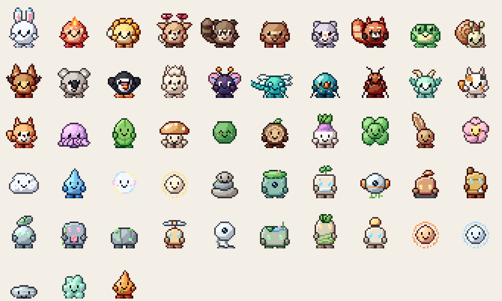
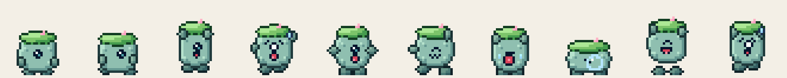

# Gremlets

Fifty one-of-a-kind pixel creatures that live on your Mac desktop: gentle animals, a few bugs, a tiny
dragon, a couple of friendly mythical beasts, gentle nature spirits (a stack of river stones, a lake moss ball, a
mote of evening light) and old guardian machines that nature reclaimed (one has a meadow growing on its head). They walk along the Dock line, hop and fly up onto
your app windows, ride along when you drag a window, tumble off when you close it, play tag with each other,
nap in piles, stand on each other's heads, throw dance parties, and show off a signature move.

**What it is now:** a desktop AI companion whose world is grown by your work with Claude Code.

- **Every project grows a bonsai.** While a Claude Code session runs, its project's tree grows out of the moss on that
  terminal window: a classic cloud-pad bonsai (a curving, tapering trunk, roots flaring at its foot, flat pads of
  foliage in an uneven triangle) that gets bigger and fuller with every session, flowers with finished tasks and
  fruits when tests pass. Species and style come from the project's name; maples turn in autumn, cherries blossom in
  spring, the deciduous ones stand bare under snow. Gremlets sit in the pads and nap there after dark. Click a tree for its story. While a session runs the growing tree is
  also the menu bar icon, and a lantern hangs from it whenever Claude is waiting for your OK.
- **The terminal comes alive while Claude works.** Ivy creeps along its top edge, mossy ledges grow out of its side
  every few edits (platforms the Gremlets use), subagents arrive as tiny helpers, a failed command brings rain, a
  passing test run a rainbow.
  When Claude compacts its context, the tree lets a few leaves go.
- **A plant in the corner, a different one every so often.** One small plant at a time stands in the bottom-left
  corner, and every 20 to 40 minutes another takes its place: a trampoline mushroom to bounce on, a lantern flower to
  warm up by, a beanstalk to climb, a snapping plant to dare, a wishing willow to sit in. Each grows a level at a time
  as Claude tasks finish (`gremlet plant` swaps it now).
- **Full screen stays out of your way.** When an app goes full screen, everything else is put away and the Gremlets
  move up to the hanging house in the top-right corner and mossy branches in the top corners. More branches come out
  only when there are more Gremlets to fit, and mossy stumps appear in the bottom corners once the top is full.
  They're shy of the pointer: move it near one and it hops somewhere else, and clicks always go through to your app
  (`gremlet fullscreen` previews it).
- **They reshape the desktop, Terraria style.** A window out of jumping reach gets a staircase of wooden blocks laid
  up to its edge, one block at a time: it turns round, pulls the block behind it up into its arms (you see each one
  arc up onto the stack it carries), turns back and sets it down ahead, so the staircase travels up with it; at the
  top it hauls the last blocks up one by one. A wide window gets a stretch of rail along
  its top and a minecart that rolls end to end, sparks flying, Gremlets taking turns. Gaps between windows get plank
  bridges, a zipline runs from a high window down to a lower one, and a grappling hook reaches the rest.
  (`gremlet stairs`, `gremlet cart`.)
- **Expeditions.** Now and then a treasure chest turns up somewhere hard to reach (the top of a tall window, a high
  ledge). A Gremlet that spots it plans a route from wherever it stands, across every trick above, and sets off: up a
  staircase, over a bridge, hook up to the next window, chest over its head, zip or glide back down to the floor
  to open it (a gem inside). When a landing goes wrong it plans again from where it ended up. Every
  so often one climbs to the highest point on the desktop just to plant its flag there. The route depends entirely on
  where your windows happen to be, and the plan flashes as a dotted line across the screen when it sets out.
  (`gremlet chest`, `gremlet expedition`.)
- **Quiet moments, never during focus:** meteor showers, a bloom festival, a lantern festival after a good day, a sky
  ferry, wind that sweeps leaves along the floor, a kite on a free afternoon, shy night spirits.
- **Companion:** talk to any Gremlet, start focus sessions, window-box gardens on nature shelves beside your
  windows, a garden journal (today, your streak, every tree's story, two weeks of Claude work, your recent sessions
  minute by minute), a morning recap, a daily postcard and a time-lapse, and a 44-second scripted demo
  you can record with one command.
- **Pictures of your work, ready to post:** `gremlet recap` (a session as a card: the tree before and after, the
  numbers, a bar per minute; one is saved automatically when a session with real work ends), `gremlet card <project>`,
  `gremlet forest` (every project's tree on one hillside), `gremlet wrapped` (a month as a poster), `gremlet snapshot`
  (a postcard of their world) and `gremlet timelapse [project]`. Everything is drawn from the same records, so a tree looks the same
  on your desktop, in a card and in the web habitat.
- **Claude talks to the Gremlets.** With the MCP server (`scripts/install-claude-extras`), Claude Code can make
  the Gremlet on its project say something, celebrate when something lands, lay out its plan as a row of planks on
  the terminal (solid as steps finish; the to-do list does the same through the hook), and ask you to come and look.
  The status line tells the Gremlets how full Claude's context is: the worker's pack swells and it yawns before a
  compaction. Click a Claude session's Gremlet to jump to that terminal window.
- **Opt-in, with your permission (menu → Your Mac):** Gremlets stand on lines of text and search fields inside the
  front window (Screen Recording; on-device text recognition, positions only), save highlight GIFs of treasure runs
  and boosts to Movies › Gremlets › Highlights (Screen Recording). Gremlets never move, resize or focus your windows
  on their own.
- **A hut beside Claude's terminal.** A mossy branch grows out of the terminal window's top corner and a little woven
  acorn hut hangs from it on a vine, its window glowing while Claude works. It hangs outside the window, swings when
  you drag the terminal, and a vine links it to the hanging house so the Gremlets visit.
- **Their home hangs under the notch.** A little house with a mossy roof hangs from the menu bar beside the notch (the
  middle of the menu bar on other Macs), with a porch, a swing, a mailbox and a hammock. Its roof follows the seasons,
  it grows a balcony, a loft and a rooftop garden as your Claude sessions add up, and its lights stay on until the
  last one turns in. When Claude goes quiet, or it's late, a Gremlet finds its way up across your windows and naps in
  the hammock or goes inside (smoke curls from the chimney); in the morning they drift down on a leaf. It tucks
  itself away whenever a window is in that space.
- **Give one a ride.** Hold ⌃⌥ and a cloud appears under your pointer: the nearest Gremlet hops on and rides
  wherever you move it. Let go to drop it onto a window.
- **Their day follows Claude.** While Claude works, the Gremlets plant and tend moss and water the plants; a couple
  of minutes after it stops, they head home or settle on a platform and rest.
- **A page for their world.** `gremlet village-page [folder]` writes a small read-only web page of their world as
  it is now (the postcard, the counts behind it, the Gremlets who live there, a share preview for X) to drop on any
  static host. Counts and Gremlet names only: no project names or anything from your sessions.
- **Weather where you are (opt-in, menu → Weather).** Type your city once (no location permission; Open-Meteo, no
  account). Rain splashes on window tops and drips off their corners, snow piles up along them and on the floor,
  wind sends the kites up. It only shows where it lands, never across your work. In the rain the Gremlets hold a
  leaf over their heads and keep the kites in; when the snow is deep they roll a snow-Gremlet together, which melts
  when the snow goes. `gremlet weather rain|storm|snow|wind` previews it for two minutes.
- **Moss that needs looking after.** It grows all the time (faster while Claude works), carpets the tops of
  windows, trickles down their sides, and weaves bridges between windows that sit side by side. It dries out and
  browns unless the Gremlets water it, so they do: they carry the watering can over, plant tufts they bring along,
  trim the thick carpets, and when a strand hangs past half-way down a window one climbs down and snips it while a
  friend holds it steady. They also slide down strands like a fire pole.
- **Things grow in the moss.** Daisies, mushrooms, berry sprigs and dandelions come up in the moss on window tops
  and grow over a few minutes. The Gremlets water the young ones, pick the daisies and mushrooms to give to a friend,
  eat the berries, and blow the dandelion clocks so the seeds drift off and start new moss on another window
  (`gremlet sprout [kind]`). Moss also creeps along the bottom of the screen from both corners (the middle stays
  clear), and things grow there too. Daisies they pick fill the window box on the hanging house through the day.
  After dark, fireflies drift over the thick moss and the Gremlets chase them (`gremlet fireflies`).
- **Gardens grow in the moss.** While Claude works, its Gremlet gardens right on the window's top edge, the plants
  coming up out of a mound of moss (no planter, no shelf).
- **Claude's mood, at a glance.** While Claude thinks between steps, its Gremlet gets a little thought cloud with
  dots filling in (and stops to look up at it now and then); when Claude needs you, it turns to you and holds up a
  glowing lantern until you answer.
- **Seasons on their own.** Cherry petals in spring, autumn leaves and snowflakes in winter let go of mossy window
  corners, the corner branches and the house now and then; in winter the moss wears a cap of snow.
- **A scrapbook.** A page a day with a flower pressed into it: what they picked from the moss, the fireflies they
  caught, the moss they planted and what Claude got done (More → Open Scrapbook). In the evening one of them
  mentions what went into today's page.
- **Say hello.** Double-click a Gremlet: it turns and waves, and tells you its name, how long you've been together
  and its favourite spot (the one where it spends the most time).
- **Acting out Claude's work.** For a few seconds after each step it holds up what Claude used: a book (reading a
  file), a magnifier (searching), a little telescope (the web), a trowel (editing), a four-leaf clover (tests,
  fingers crossed), a list (the plan). Its rucksack fills as Claude's context does and gets unpacked when Claude
  compacts. Seedling helpers hop along the window top while subagents work and come back with a leaf. The plan is a
  row of mossy stepping stones that light up step by step. After three minutes waiting on you it taps the glass
  (at most every four minutes). When the session ends it waves and carries a lantern home.
- **A day in the garden.** Each task Claude finishes plants a tiny flag in the moss on its window top (they stay all
  day). Two failed commands in a row and the Gremlet sits down with a rubber duck to talk it through, then cheers
  when something works. A day of passing tests makes the moss lush; a bad run of failures and it gets windswept.
  At lunchtime a few of them have a picnic in the moss; late at night one brings you a tiny blanket. When Claude
  finishes, its Gremlet holds up a little sign with the first words of Claude's summary. A friend's visiting
  Gremlets bring a seed that grows a flower in their own colour. While you type fast they go quiet and tiptoe, and
  when you stop they stretch and play (`gremlet picnic`, `gremlet blanket`, `gremlet friendseed`).
- **Your iPad, too.** Put the iPad beside the Mac as a Sidecar display and the Gremlets walk over and live there
  as well, with their own nest hut, leaf swing and branches. Full screen on the Mac only tidies the Mac's screen.
- **Anniversaries.** Every thirty days together (and at a year) a Gremlet wears a flower crown all day, and the
  scrapbook remembers it.
- **Top-corner hangouts.** A woven nest hut (top left) and a big leaf swing (top right) hang on vines from the top
  of the screen, with a mossy branch below each, where they rest when Claude is
  quiet; they hop out of the pointer's way there and clicks always go through to your app.
- **Moss takes over.** The longer Claude works, the more the desktop grows over: moss creeps in from the ends of
  every window's top edge, strands hang down window sides, and after a long day the
  carpets meet, flower and sprout mushrooms (glowing at night) and moss fringes the menu bar and the floor. It
  recedes slowly when Claude is idle. The Gremlets plant and water tufts of it along window tops and climb a window's
  strand up onto its top. A Claude tab dragged out into its own window takes its tree and ivy with it
  (macOS asks once to let Gremlets read which Terminal window holds the tab). (`gremlet moss [minutes]` to preview.)
- **They help each other, and notice your Mac.** A window just too high to jump? A friend walks to its foot, braces,
  and heaves the climber up off its head ("Hup!"). Press ⌘⇧4 and everyone strikes a pose before you take the shot.
  Battery low, one holds up a little battery sign (and cheers when you plug in); the internet drops, one holds up a
  "no signal" sign until it's back. No permissions: only the screenshot tool's window name, the battery level and
  the network state are read. (`gremlet boost`, `gremlet react screenshot|battery|offline|online`.)
- **Visit a friend's Mac.** Menu → Visit a Friend's Mac → Invite a Friend gives you a code; your friend joins with
  it. A hollow mossy log appears at the edge of each screen and glows while the other Mac is online. Every few
  minutes one of your Gremlets dives into the moss and pops out through the log onto their screen (Send One Over Now
  does it at once, even for a napper); visitors bring a seed from home and head back after a few minutes, and one
  that comes back brings a postcard: the hanging house's mailbox flag goes up until someone goes home and takes it in.
- **Busy without Claude.** On a Mac where Claude Code hasn't been used in the last day, the Gremlets keep their own
  busy day: gardening, planting moss on far windows and widgets, hopping along the Dock, visiting critters. Moss
  starts creeping in from the first launch.
- **Widgets, the Dock and critters.** Desktop widgets are little mossy stones: moss grows on them and Gremlets set
  off to plant it there. With Play on the Dock (Accessibility), the Dock's icons become stepping stones: they hop
  across them, cheer an app you open (a Gremlet standing on a bouncing icon goes flying), knock on an icon that gets
  a new badge, wave an app goodbye when it quits, and nap on the Trash. Ladybugs, bees and little snails live in the
  moss in the daytime; a ladybug climbs onto a Gremlet's hand to say hello. (`gremlet critters`, `gremlet dock`.)
- **The hanging home.** The house under the notch (or, on a Mac without one, the nest hut in a top corner; it moves
  to the other corner when widgets fill the top-left) has a pantry: a woven acorn hanging off the porch. Gremlets
  forage in the moss for seeds, berries, acorns and mushrooms and float home under a dandelion to stock it; come
  evening, a couple of them go up for supper on the porch. The house grows with Claude sessions *and* with that
  care (a balcony, a loft, a rooftop garden, then a birdhouse and a string of lights), so a Mac without Claude sees
  it grow too. Rest the pointer on it and it swings on its ropes, and whoever's napping inside comes out to wave
  (hovering only: the corners stay click-through). A little bird drops by now and then, perches on the roof, a
  widget or a window top, gets a wave, sometimes leaves a seed in the pantry, and flies off if the pointer comes
  close. (`gremlet bird`, `gremlet nudge`, `gremlet pantry`.)
- **The rain barrel and the basket lift.** A barrel at the end of the porch fills when it really rains where you are
  (and a little with the morning dew). When the moss is getting dry, a Gremlet floats up, fills its can, and comes
  back down to water: rainwater does the moss twice the good. A woven basket hangs on a rope under the porch: a
  Gremlet on the window top below waves it down and rides it up home, hand over hand (and back down again). It only
  goes a short way, so the rope stays up in the corner; if the window moves or closes mid-ride, the rider hops out.
- **The vegetable patch.** A little bed in front of the nest hut: Gremlets float up to sow carrots, radishes and
  peas, water them (from the rain barrel when there's some; rain waters them too), and pick what's ripe for the
  pantry. Left dry, it stops growing and droops until someone comes. (`gremlet patch [ripe]`.)
- **Postcards.** A mailbox hangs under the porch. A Claude session that finishes while you're away leaves a postcard
  in it (how long, edits, tasks done, whether the tests pass) and the little red flag goes up; when you're back, a
  Gremlet mentions it. Rest the pointer on the mailbox to read them. (`gremlet postcard` posts a sample.)
- **Lanterns on the moss.** Come dusk, Gremlets set tiny lanterns along the mossy window tops. They glow all night,
  go out at dawn, and get taken in during the morning. A lantern goes with its window. (`gremlet lanterns`.)
- **Bees.** Once the house has grown a little, a straw hive hangs off the nest hut. In the daytime its bees loop out
  to the vegetable patch and back: the patch grows faster, and a picking sometimes comes with something extra.
- **Seasons on the porch.** Autumn leaves pile up on the hut's roof and porch, winter snow settles there (faster when
  it's really snowing), spring blossoms drift off the roof. Now and then a Gremlet floats up with a broom and sweeps
  it all off. (`gremlet porch leaves|snow|clear`.)
- **The firefly jar.** Fireflies caught at night go into a jar on the rain barrel's lid and light the porch; at dawn
  they're let go. (`gremlet jar`.)
- **Seed swap.** A Gremlet back from a friend's Mac brings seeds from there, and a friend's Gremlet visiting brings
  seeds from theirs: strawberries, pumpkins and tomatoes join the carrots, radishes and peas. (`gremlet seeds`.)
- **The morning postcard.** Each morning, the first time you're about, the mailbox has a card about yesterday:
  Claude tasks and edits, what was picked from the patch, birds, fireflies, suppers, lanterns. (`gremlet morningcard`.)
- **Right up under the menu bar.** A window filling the screen still gets moss along its top and strands down its
  corners, and Gremlets can stand on it, but only below the empty stretches of the menu bar, never in front of the
  menus, the status icons or the notch. (Reading where the app's menus end needs Accessibility; without it, they
  keep to the right of the notch.)
- **Ask them things.** Right-click a Gremlet for what it could do right now from where it stands: tend the moss,
  forage, fetch rainwater, ride the basket, tend the vegetable patch, set out a lantern, sweep the porch, build a staircase, lay a minecart track, go home for a nap, play with a friend, say hi to the critters,
  hop the Dock, fly a kite, go on an adventure, visit your friend's screen, or just give it a berry. Asleep, the only
  thing on offer is waking it. (`gremlet ask` lists the options per Gremlet; `gremlet ask stairs` does one.)
- **Walk off the Mac onto your iPad.** Link another screen (an iPad, a phone, a friend's laptop running the web
  habitat; the Gremlets menu shows a QR code) and put it against one edge of your Mac. A Gremlet that wanders to that
  edge walks straight off the Mac and in from the opposite edge of the other screen, keeping its stride and speed
  (mid-air if it jumped), and wanders back the same way. A hollow log glows at the edge while the other screen is
  open. `gremlet link right`, `gremlet cross`. While the screens are linked, the sky ferry sails out through the
  doorway with whoever is aboard, drops them off on the other screen, takes a couple of Gremlets from there on board
  and sails back to the Mac (`gremlet ferry cross`).
- **Phone:** or send a Gremlet through a portal to your phone and back.

- **Download:** [latest release](https://github.com/Braydon2622/gremlets/releases/latest) (macOS 13+, Apple Silicon) ·
  **Try it in a browser:** [braydonhartai.com/gremlets](https://braydonhartai.com/gremlets/) · **Guide:** see below
- **Built with:** Swift (AppKit + Core Animation) on a platform-independent engine (`GremletsCore`, no AppKit), a
  JavaScript port of the engine for the web, Claude via the Messages API, Claude Code hooks, a Solidity contract
  (testnet), and a free pub/sub relay for the phone link.
- **Engineering:** 132 engine tests (physics, gardens, platforms, stairs, minecarts, ziplines, multi-leg expeditions, the doorway to a linked screen, bonsai growth and placement, kites, a boss-free event
  system, a 10-minute soak test), 2–4% CPU with twenty creatures,
  adaptive frame rate, no permissions needed by default, safe-at-work hiding during calls, loopback-only control
  server with header and Host checks.

> 🎥 `gremlet demo` plays a 44-second scripted Claude session on your front window and saves it as a video and a
> looping GIF in Movies › Gremlets, so a demo is one command away.



| Family | Count | Some of them |
|---|---|---|
| Animals | 15 | Flurrie the frost bunny, Dandelet the dandelion lion cub, Capyzen the hot-spring capybara, Calicat the calico kitten |
| Spirits | 15 | Glowmote, Pebblin the stone stack, Marimoss the lake moss ball, Sakurin the cherry blossom, Puffcloud |
| Guardians | 13 | Mosswarden with a meadow on its head, Pondhead with a rain pond on its head, Ivybolt, Beaconbit, Slumberbolt |
| Insects & Bugs | 4 | Silkwing the butterfly, Zipwing the dragonfly, Prismite the jewel beetle, Snipleaf the leafcutter ant |
| Mythical | 2 | Kindlet the candle spirit, Inklet the baby kraken |
| Dragons | 1 | Mintwyrm the jasmine dragon |

Full catalog with personalities and signature moves: [docs/SPECIES.md](docs/SPECIES.md).

Every creature has 20 animations (83 frames): idle, look-around, walk, run, crouch, jump, fly, a panicked fall,
a squash landing, dizzy, a big yawn, sleep with a snot bubble, a startled wake-up, a happy jump, petting bliss,
dance, wave, dangling when dragged, an "!" alert, and its signature move.



All creatures, names and art are original. The design approach borrows *principles* from classic
creature-collecting games and gentle folk-tale nature spirits (a readable silhouette, one strong
signature feature, 2–3 soft colours, and a touch of nature magic: frost ears, a petal mane, a boulder
that wakes up) without copying any existing character. No Gremlet wears clothing or carries props.

## Features

- **Click-through overlay.** Transparent, borderless, always-on-top panels on every screen. Clicks pass straight
  through to your apps except on a creature's opaque pixels (per-pixel hit testing).
- **Window surfaces.** Creatures stand and walk on the top edges of real app windows, ride along when a
  window moves, and fall when it closes, minimizes or gets covered.
- **Physics.** Gravity, one-way platforms, wall bounces, and drag-and-throw using the cursor's release velocity.
  Hard landings kick up dust, and really hard ones leave a creature dizzy with stars circling its head.
- **Flight.** Winged species (butterflies, bats, dragons, the griffin...) take off and flutter to other windows.
- **Social life.** Creatures notice each other: they walk over and wave hello, play tag (and swap roles when
  tagged), follow a friend around, curl up next to a sleeping friend, hop onto a friend's head and ride along,
  bonk into each other, and join in when someone starts dancing.
- **Signature moves.** Each species has one: fire breath, steam puffs, a fiddle tune, a rainbow fan display, ink
  clouds, a dino stomp, a three-headed bark...
- **Cursor play.** They turn to look at your cursor, wave at it, chase it (with an "!" first), get startled by a
  fast swipe (fliers take off), and melt into a happy wiggle when you rub the cursor over them.
- **Behavior AI.** A utility-scored brain picks what to do next from energy, species traits and surroundings.
- **Multi-monitor and Spaces.** One overlay per screen, creatures can walk across touching monitors, and the
  overlay follows you onto every Space and over full-screen apps. They also sneak to screen edges to peek around them.
- **Menu bar app.** Add any of the 50 (grouped by family) or a random party of 5, send them home, pause,
  launch at login, and open the custom sprites folder.
- **Bring your own art.** The app loads Aseprite JSON exports directly (see below).
- **Low CPU.** About 1–3% CPU with eight creatures on an Apple Silicon MacBook (see Performance).

## Companion features

**Safe to keep running at work.** Gremlets slip off screen whenever any app is using your camera or microphone
(Zoom, Meet, FaceTime...), so they never show up in a screen share, and come back a few seconds after the call (macOS's own "Hey Siri" and dictation listeners don't count as a call)
ends. *Hide During Calls* turns this off. **⌃⌥G** hides or shows them from anywhere (or `gremlet hide` / `gremlet show`
in a presentation script). Hidden panels are removed from the screen entirely, not just made transparent, and the
app drops to about 0% CPU. No permissions are needed: macOS reports whether a camera or mic is in use without
giving out any audio or video.

**They notice when you're away.** After 5 minutes without keyboard or mouse input they settle down for a nap (and
the loop slows down). When you come back they wake up and one waves hello. On Low Power Mode the animation loop is capped
at 30 Hz.

**Focus buddy.** Menu bar → *Focus for 25/50 min*. A countdown appears next to the menu bar icon; your Gremlets
settle down and doze while you work (no flying, no tag), then wake up and throw a dance party when your break
starts, and one waves when the break is over. The menu shows today's focused minutes and your
day streak, and every Gremlet that keeps you company through a session grows closer to you. Optional
*Water & Stretch Reminders* every 45 minutes. Late at night
they get sleepy faster, a gentle hint to log off.

**Coding companion.** A tiny local control channel lets scripts make your Gremlets react:

```bash
scripts/gremlet run npm test      # dance if the tests pass, fall over dizzy if they fail (exit code preserved)
make && scripts/gremlet pass || scripts/gremlet fail
scripts/gremlet done              # after any long job: the nearest Gremlet pops up and waves
scripts/gremlet focus 50          # start a focus session from the terminal
scripts/gremlet hide              # before presenting; `gremlet show` brings them back
scripts/gremlet say "Deploy finished" 10   # a Gremlet pops up with a speech bubble (plain text, max 120 chars)
source scripts/gremlet-shell-hook.zsh   # zsh: a Gremlet waves (or keels over) when any command takes over 30 s
```

**Gardening.** While you're at your Mac, a Gremlet now and then takes up gardening. Usually it hangs a shelf on the
side of a nearby window, or on the wall (the screen's edge) when no window has room, and floats up there holding a giant dandelion
puff, or gets bounced up by a mushroom that pops out of the ground; it drifts back down under a big leaf. Every platform
is something from the forest, and moss creeps out along it while it's in use: a wooden plank, a mossy stone ledge, a
living leaf that sways, a bracket fungus, or (on the screen's sides only) the limb of a whole tree that grows up
there, an oak, pine, maple, birch, cherry or willow, each turning its own colour in autumn, or a treehouse porch with a
little cabin up in it; or (for floor gardens) the mossy shell of a giant garden snail that crawls slowly along the
bottom of the screen, eyestalks wiggling. Moving platforms carry their gardener along. Click a platform and it reacts:
the leaf rustles, the snail pulls its eyes in, the treehouse chimney puffs smoke. Birds drop by to perch on the end now and then. One Gremlet per shelf; window shelves ride along when you move the window and don't care if another window
covers it. Sometimes it gardens right on the floor instead. On the shelf
sits a window box with three spots. The Gremlet plants a seed in each, waters whichever plant is getting dry (the soil
darkens when it's wet), shoos off aphids and pulls weeds, and the plants grow through five stages: seed, sprout, young
plant, bud, bloom. Eight kinds turn up, from common (tulip, daisy, carrot) to uncommon (strawberry, tomato, cactus) to
rare (sunflower, mushroom); rare seeds show up more often during a focus session, when everything also grows faster.
Butterflies visit while something's in bloom.

There's a lot to find. Nineteen plants in five tiers: common (tulip, daisy, carrot, lavender), uncommon (strawberry,
tomato, cactus, bluebell), rare (sunflower, mushroom, a Venus flytrap that snaps up its neighbours' aphids, plus cherry
blossom in spring and frostbell in winter), epic (crystal rose, a sparkling star lily, and the moonflower, which is only
planted after dark and glows when it opens) and legendary giants that take up the whole window box (a giant pumpkin,
likelier in autumn, a wishing tree with glowing fruit, and a bonsai).
About one plant in forty comes up golden and sparkles. A rain cloud sometimes drifts over a box and waters everything,
leaving a rainbow; a ladybug sometimes beats the gardener to an aphid; fireflies come out around the gardens at night;
and a shooting star now and then grants a wish (the next seed will be epic or better). When a harvest has something
special in it, the gardener offers it to you. A few things are left for you to discover. When the whole box has bloomed it's harvested and planted along the
bottom of the screen, so a busy week leaves a real little garden, which the Gremlets come by to water.

You can help: rest the cursor on the gardener or its box to see how each plant is doing ("Tulip 60% · Carrot is
thirsty · Daisy has a bug!"), and click the box to shoo a bug or water the driest plant. The menu's *Seed Book* shows
which kinds you've grown (new ones get a speech bubble), plus how many plants you grew today. When you step away the
gardener dozes beside its box until you're back, and in the evening a lantern glows under the shelf. At most two
gardens run at once, with a few minutes' rest in between. `gremlet hobby [shelf|floor]` starts one now.

**Claude buddy.** Send Claude Code a prompt and a Gremlet floats up to a shelf on the side of that Claude window (or
flies, if it has wings) and tends a window box for as long as Claude works; the plants never quite bloom until Claude
is done, then the whole box bursts into flower (rare seeds are a bit likelier on Claude's shelf). Then it shows it off and says "SalesCheatCodeLive: Claude is done ✓" (or "PhotoToPart: Claude needs your OK" when Claude is
waiting on you), and floats back down a little later. Each Claude session gets its own Gremlet, the menu counts what
they made today, and *Claude Buddy* in the menu turns it off.

`scripts/gremlet-claude-hook` connects Claude Code's `UserPromptSubmit`, `Stop`, `Notification`, `SessionEnd`, `PostToolUse`, `PostToolUseFailure`, `SubagentStop` and
`PreCompact` hooks
(setup is in the script's header). It sends only the event, the session id, the project folder's name and a process id.
The app finds the window by walking up from that process to the terminal or editor that owns it (process ids and
window bounds only, never titles or contents). A window with no room beside it (full width) gets a Gremlet working on
the floor below it. The engine side (`GremletsCore/Work.swift`) is pure Swift with its own tests.

It listens on `127.0.0.1:47920` only, every request needs an `X-Gremlets` header (so a web page can't trigger it
cross-site without a CORS preflight, which it never approves), and it can only trigger animations and the timer.

**Bond.** Each Gremlet remembers days and hours together, pets, pokes and focus sessions, and levels up from *New friend* to
*Kindred spirit*. Closer friends wave at your cursor and follow it more, and from *Friend* up they show off their
signature move when you pet them. A level-up sets off a shower of hearts. See *Your Gremlets* in the menu.

## Run it

Requires macOS 13+ and Swift 5.9+ (Xcode or just the Command Line Tools; `scripts/bundle.sh --universal` builds an
Apple silicon + Intel app with either).

```bash
swift run Gremlets                                      # dev run
swift run Gremlets --spawn flurrie,kindlet,mosswarden       # pick who shows up
scripts/bundle.sh && open build/Gremlets.app            # real app bundle (needed for Launch at Login)
swift test                                              # engine tests, including a 10-minute simulated soak test
swift run spritegen                                     # regenerate all 50 sprite sheets
```

No permissions are required: window *positions* are readable without Screen Recording access (only window
titles need it, and Gremlets never reads them).

**Inside windows and on the desktop.** Browser windows (Chrome, Safari, Arc, Edge, Firefox...) have a ledge along the
bottom of their tab and address bar, and Finder windows one along the toolbar, so Gremlets can hop down into a window
and walk along it (where nothing covers it). Turn on **Play with Desktop Icons** and your desktop icons become tiny
platforms too: Gremlets float or fly up to sit on them, an icon boings when one lands on it, and now and then a Gremlet
borrows one, carries it around over its head and tosses it back into place. Nothing on your desktop is moved: the
carried icon is a copy, and its spot is covered with a matching piece of your wallpaper until it's back. Icon positions
come from Finder, so macOS asks once to let Gremlets control Finder.

## Your AI companion

**Chat with any Gremlet**: double-click it, choose **Chat with a Gremlet…** in the menu, or open `gremlets://chat`. Each
one talks in its own personality (a frost bunny is not a candle sprite), knows its nickname and how close you two are,
remembers your recent conversation, and knows how your day is going: minutes focused and your streak, plants grown,
seeds found, Claude tasks finished alongside it. Ask it to help you focus, garden, dance, hide for a meeting or make a
wish and it does (replies can carry one of a small, fixed set of actions; anything else is ignored). It also says good
morning the first time you're around each day and recaps your day in the evening.

Replies come from Claude (`claude-opus-5-5` at low effort, about a cent a message, with server-side fallback) once you
paste an Anthropic API key on the chat page; it's stored in your macOS Keychain, never in a file. Without a key, or if
the account is out of credits, the Gremlets answer with built-in lines and still do everything above; the page says
why in plain words.

**Plug it into anything** with the `gremlets://` URL scheme: `gremlets://say?text=Deploy%20done`,
`gremlets://focus?minutes=50`, `gremlets://hobby`, `gremlets://dance`, `gremlets://wish`, `gremlets://chat?name=kindlet`,
`gremlets://send?name=kindlet`. That works from Apple Shortcuts, Raycast, Alfred, Stream Deck, cron or any script
(`open "gremlets://..."`), alongside the `gremlet` command and the Claude Code hooks.

## Gremlets on your phone

**Pair with Phone…** in the menu (or `gremlet pair`) shows a QR code; scan it with your iPhone and the web habitat opens
already linked (Share → Add to Home Screen keeps it one tap away). Then **Send to Phone** (or `gremlet send kindlet`):
the Gremlet hops into a swirling portal on your Mac and pops out of one on your phone, where it sets up a window box on a
ledge and keeps gardening: same plants, same art, tap the box to water it or shoo a bug. Tilt the phone and everyone
slides that way; tip it far enough and they tumble off their ledges. **Send home** on the phone brings
it back through the portal with everything it grew, which goes into the Seed Book and the garden along the bottom of
your screen.

How it works: both sides pass tiny JSON notes through [ntfy.sh](https://ntfy.sh), a free public relay that needs no
account, on a channel named after a long random pairing code ("kindlet is jumping to the phone", "kindlet is coming home
with a carrot and a crystal rose"). Only Gremlet names and plant kinds are sent. The Mac keeps one streaming connection
open (no polling) and the page uses Server-Sent Events; the code is removed from the page's address bar as soon as it's
saved. Anyone who learned the code could read those notes, so **Unlink Phone** makes a fresh one next time.

## Web habitat (phones, tablets, any browser)

`web/` is the same world in a browser tab: a JavaScript port of the engine (`web/js/engine.js`, same rules
and tuning as the Swift core) plus a canvas renderer that uses the exact same sprite sheets. Since a browser
has no app windows, Gremlets climb floating shelves, mossy ledges and clouds instead. The sky follows your
local time (day, dusk, night with stars).

- **Touch & mouse:** tap to poke, hold to pet, drag to throw, and they chase your finger.
- **Picker:** add any of the 50 (grouped by family), or Shuffle for a random group. Up to 12 at once.
- **Showcase mode:** `index.html?showcase=kindlet` shows one Gremlet with its nameplate, sized for an NFT's live preview.
- **No build step:** plain ES modules, so it can be hosted anywhere static.

```bash
python3 -m http.server 8765        # from the repo root, then open http://localhost:8765/web/
open http://localhost:8765/web/dev-preview.html   # phone-size + NFT-preview frames side by side
scripts/test-web.sh                # engine tests (incl. soak test) in macOS's built-in JavaScriptCore, no Node needed
```

## NFTs (testnet)

Each of the 50 Gremlets is a one-of-a-kind collectible; owning Gremlet #N unlocks it in the desktop app.
- `contracts/`: minimal ERC-721 on OpenZeppelin 5.1.0, Foundry tests (incl. fuzz), 100% coverage. No payment
  logic, no upgrades, max supply fixed at 50, optional permanent metadata freeze. See [contracts/README.md](contracts/README.md).
- `nft/console.html`: dependency-free creator console that deploys and mints from your own browser wallet
  (keys never leave the wallet; Base Sepolia testnet only). Verified end-to-end against a local `anvil` chain.
- `nft/metadata`, `nft/images`: ERC-721 metadata with portraits, traits and a live `animation_url` into the web habitat.

### Wallet-verified unlocks in the desktop app

Gremlets you hold stay on your desktop as long as you like. Everyone can try any other Gremlet in a **demo**
(3 at a time, 15-minute sessions; when time's up they wave goodbye and head home). Your own drop-in sprites are
never gated.

1. Menu bar → **Connect Wallet…** opens a small page served by the app on `127.0.0.1`.
2. Your browser wallet signs a plain text message with a one-time nonce. That's free: no transaction, no
   permissions, and the app never sees a private key or seed phrase.
3. The app recovers the signer by calling the chain's `ecrecover` precompile (so no elliptic-curve code ships in
   the app), checks it matches the wallet, then reads `ownerOf(1…50)` in one batched JSON-RPC call.
4. Only the public address and the owned token ids are stored. Ownership is re-read every few hours, so a sold
   Gremlet goes back to demo mode.

Safety details: the app refuses any network that isn't Base Sepolia (chain id 84532). Nonces are single-use and
expire after 10 minutes. High-s (malleable) signatures are rejected. The local server checks the `Host` header
(blocking DNS rebinding) and sends a strict CSP on the page. Keccak-256, EIP-191 hashing and EIP-55 checksums are
implemented in `GremletsCore` and tested against Foundry's `cast`. Verified end-to-end against a local `anvil`
chain: a real owner proof, an impersonation attempt, nonce replay, a transferred token, and a wrong-chain node.

Gating switches on once `nft/deployment.json` (chain + contract address, written by the console after deploying)
is present. Until then the build is a preview with everything unlocked. `--visitor` previews demo mode;
`--unlock-all` turns gating off.

## Drawing your own Gremlets

1. In Aseprite, draw your frames (any size; 32×32 matches the built-ins) and add **tags** named
   `idle`, `walk`, `jump`, `fall`, `land`, `sleep`, `react`, `drag`, and optionally `look`, `run`, `crouch`, `fly`,
   `dizzy`, `yawn`, `wake`, `pet`, `dance`, `wave`, `alert`, `special`. Only `idle` is required; missing ones fall
   back sensibly. Draw the creature **facing right** with its feet on the bottom row.
2. **File → Export Sprite Sheet**: Layout *Horizontal Strip*, Output ✔ JSON Data (Array or Hash), ✔ Tags.
   Name them `sheet.png` and `sheet.json`.
3. Put both in `~/Library/Application Support/Gremlets/Species/<your-id>/` (menu bar → *Open Custom Sprites Folder…*).
4. Optional `species.json`:
   ```json
   { "name": "Glimmet", "element": "spark", "family": "insect", "scale": 3, "walkSpeed": 70,
     "jumpPower": 1.0, "sleepiness": 1.0, "flies": true, "special": "sparkle" }
   ```
5. Restart Gremlets. A folder with the same id as a built-in species replaces it.

The built-in species come from `swift run spritegen` (`Sources/spritegen/`), a small part-based pixel-art
renderer. Each species is a data recipe (body shape, ears, horns, wings, tail, markings, held item, palette)
built from a library of ~70 parametric parts. Shared poses drive squash and stretch, arms, legs, wing flaps
and facial expressions, so all 50 creatures animate consistently. Rounded parts get spherical shading from a
top-left light, with hue-shifted colour ramps and a selective outline, so bodies read as volumes even at 32 px.

## Architecture

```
Sources/
  GremletsCore/     platform-agnostic engine (no AppKit), unit tested
    World.swift       simulation: physics, grounding, window riding, flight, bumps, stacking, input
    Social.swift      greet, follow, nap together, tag, stack, dance parties, signature moves, peeking
    Companion.swift   focus mode, signals (pass/fail/done...), bond levels
    Presence.swift    hide on calls / boss key, away + welcome back, Low Power cap, focus log + streaks
    Ownership.swift   owned / custom / demo rules, demo session clock, Ethereum encoding (EIP-191, ABI, EIP-55)
    Keccak.swift      dependency-free Keccak-256
    Brain.swift       utility AI: scores candidate actions and picks one by weighted random choice
    Surfaces.swift    turns screens + windows into one-way platforms, with occlusion
    Creature.swift    state (activity, energy, facing, social role), per-pixel hit testing
    Species.swift     animation timing, alpha masks, traits, decoupled from any image type
  Gremlets/         macOS front end
    Overlay.swift     click-through NSPanels, CALayer rendering, mouse input, particle effects
    WindowTracker.swift  CGWindowList → window frames (y-flipped into Cocoa space)
    SpriteLibrary.swift  Aseprite JSON loader + alpha masks
    App.swift         adaptive game loop, menu bar, roster persistence, perf monitor
    Companion.swift   focus timer, bond storage, local control channel (127.0.0.1)
    SystemSignals.swift  camera/mic-in-use (CoreMediaIO/CoreAudio), idle time, Low Power, Carbon global hotkey
    Wallet.swift      wallet-link page + signature check, read-only JSON-RPC ownership reads (Base Sepolia)
  spritegen/        part-based pixel-art generator for the 50 built-in species
web/
  js/engine.js      JavaScript port of GremletsCore (tested headlessly with JavaScriptCore)
  js/habitat.js     canvas renderer, scenery, touch/mouse input, picker, showcase mode
  js/sprites.js     Aseprite sheet loader + alpha masks;  js/effects.js  pixel particles
```

Details and design decisions: [docs/ARCHITECTURE.md](docs/ARCHITECTURE.md).

## Performance

Measured with `GREMLETS_PERF=1` (prints process CPU% every 10 s from `getrusage`), release build,
MacBook (Apple Silicon), macOS 15:

| Scenario | CPU |
|---|---|
| 3 creatures walking/jumping (30 Hz loop, 10 Hz window polling) | 1.6–2.0% |
| 6 creatures (15 animations each, particles) | 2.0–2.4% |
| 8 creatures (v3: flight, tag, dance parties, mostly at 60 Hz) | 1.0–3.2% |
| 3 creatures with call/idle detection running once a second | 1.0–2.1% |
| Hidden (on a call or ⌃⌥G) | ~0% (2 Hz housekeeping only) |

How it stays cheap:
- The loop rate adapts: 60 Hz only while something is flying, running, airborne or being dragged, 30 Hz while walking, 12 Hz when everyone is idle or asleep.
- Window polling (the most expensive call) runs at about 3 Hz when nobody stands on a window, 10 Hz when someone does, and 60 Hz only while that window is moving.
- Sprite layers only get new `contents` when the animation frame actually changes. All particles (hearts, notes, fire, stars) are fire-and-forget Core Animation, so they cost no per-frame CPU.
- Timer tolerance lets macOS coalesce wakeups.

## Roadmap

- [x] Creatures notice each other (greet, tag, follow, nap, stack, bump, dance)
- [x] Peek around screen edges
- [x] Web habitat (phones + live NFT view)
- [x] NFT contract: 50 one-of-a-kind ERC-721 tokens (OpenZeppelin, 18 tests, 100% coverage), creator console, metadata + portraits. Testnet only.
- [x] Focus buddy, coding companion (`gremlet` command), bond levels
- [x] Wallet-verified unlocks in the desktop app (+ demo mode for visitors)
- [ ] Host web habitat + metadata (GitHub Pages)
- [ ] Demo GIF + signed/notarized download
- [ ] Windows port of the platform layer (the engine is already platform-independent)
