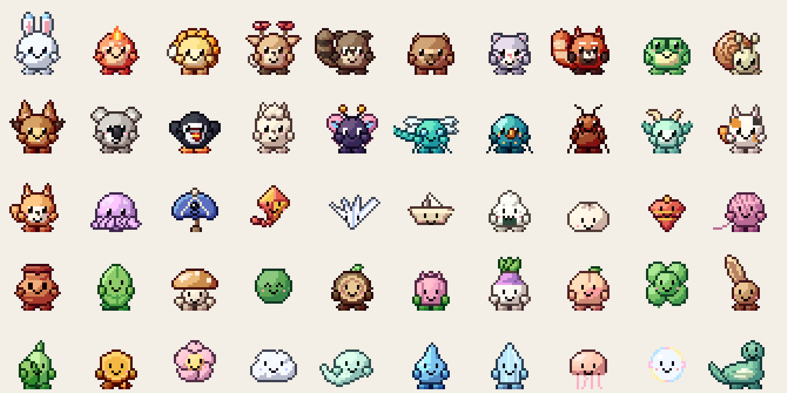

# The 50 Gremlets

Each Gremlet is a one-of-a-kind original design. This file is generated from `Species/*/species.json`.

## Animals (15)

| # | Gremlet | Element | Signature move | Flies | |
|---|---|---|---|---|---|
| 1 | **Flurrie** | frost | snow |  | A snowball bunny with icicle ear-tips. Leaves a little frost wherever it hops. |
| 2 | **Dandelet** | bloom | petals |  | A dandelion lion cub with a petal mane. Its puff tail scatters seeds when it bounces. |
| 3 | **Mossfawn** | grove | leaves |  | A forest fawn whose antlers sprout tiny red mushrooms after it rains. |
| 4 | **Pomble** | trickster | leaves |  | A pot-bellied tanuki who keeps a leaf on its head for luck and drums its tummy when happy. |
| 5 | **Capyzen** | onsen | steam |  | A hot-spring capybara so calm that birds land on it. Nothing ruffles it. |
| 6 | **Seedcheek** | harvest | seeds |  | A dwarf hamster whose cheeks are always stuffed with snacks it's saving for later. |
| 7 | **Rustle** | autumn | leaves |  | A red panda with a striped autumn tail. Stands up tall to look bigger when surprised. |
| 8 | **Lilypip** | pond | bubbles |  | A round pond frog that hops much higher than anyone expects. |
| 9 | **Swirlby** | dew | bubbles |  | A snail with a perfectly round swirl shell. It's never late, just taking the scenic route. |
| 10 | **Duskwing** | night | sparkle | ✓ | A golden flying fox that sleeps all day and flutters out at dusk. |
| 11 | **Gumleaf** | eucalyptus | petals |  | A very fluffy koala who insists on being called Your Fluffiness. |
| 12 | **Puffling** | sea | bubbles | ✓ | A puffin chick with a beak too big for its face and a lot of confidence. |
| 13 | **Alpocco** | highland | notes |  | A fluffy alpaca with a cloud of a hairdo. Hums when it's content. |
| 14 | **Calicat** | hearth | sparkle |  | A calico kitten that naps in every sunbeam and chases every dust mote. |
| 15 | **Shibun** | village | bark |  | A shiba pup with a curly tail and a smile that never quite turns off. |

## Insects & Bugs (4)

| # | Gremlet | Element | Signature move | Flies | |
|---|---|---|---|---|---|
| 16 | **Silkwing** | silk | sparkle | ✓ | A fuzzy butterfly with stained-glass wings that glitter in the light. |
| 17 | **Zipwing** | breeze | sparkle | ✓ | A dragonfly with huge shiny eyes. Zips everywhere, stops for nothing. |
| 18 | **Prismite** | prism | sparkle |  | A jewel beetle whose shell throws tiny rainbows on the wall whenever the sun hits it. |
| 19 | **Snipleaf** | colony | leaves |  | A leafcutter ant that can lift ten times its weight and loves to show off. |

## Dragons (1)

| # | Gremlet | Element | Signature move | Flies | |
|---|---|---|---|---|---|
| 20 | **Mintwyrm** | jasmine | steam |  | A tiny mint-green wyrm that smells faintly of jasmine tea. |

## Mythical Beasts (3)

| # | Gremlet | Element | Signature move | Flies | |
|---|---|---|---|---|---|
| 21 | **Kindlet** | ember | fire |  | A melting-candle sprite whose flame flares when it's happy and dims to an ember when it naps. |
| 22 | **Inklet** | deep | ink |  | A baby kraken that squirts a little ink when it gets startled. |
| 23 | **Nessle** | loch | bubbles |  | A shy lake monster that pops up wherever there's a puddle. Blurry in every photo. |

## Spirits (27)

| # | Gremlet | Element | Signature move | Flies | |
|---|---|---|---|---|---|
| 24 | **Kasakko** | rain | rain |  | An old paper umbrella that woke up one rainy night. Hops around on its one leg looking for puddles. |
| 25 | **Kitekin** | wind | leaves | ✓ | A kite that snapped its string and decided it liked being free. |
| 26 | **Foldwing** | paper | sparkle | ✓ | A paper crane folded with a wish inside. It flaps a little stiffly. |
| 27 | **Boatlet** | puddle | bubbles |  | A folded paper boat that sails across the desktop as if it were a pond. |
| 28 | **Riceling** | picnic | seeds |  | A rice ball from a picnic basket who wandered off to see the world. |
| 29 | **Baobun** | steam | steam |  | A steamed bun spirit that's always a little bit warm and smells like a bakery. |
| 30 | **Toplet** | festival | sparkle |  | A wooden spinning top from a summer festival. It never gets dizzy, mostly. |
| 31 | **Yarnbit** | hearth | sparkle |  | A ball of yarn that rolled under the sofa and came back alive. Trails a loose thread everywhere. |
| 32 | **Kilnby** | clay | steam |  | A little clay pot that came alive after a hundred years on a shelf. Hollow eyes, warm heart. |
| 33 | **Leaflet** | spring | leaves |  | The first leaf of spring, which hopped off its branch to have a look around. |
| 34 | **Puffcap** | forest floor | pollen |  | A mushroom spirit that puffs out a little cloud of golden spores when it laughs. |
| 35 | **Marimoss** | lake | bubbles |  | A moss ball from the bottom of a quiet lake. Floats up whenever it's happy, which is always. |
| 36 | **Loglet** | woodpile | leaves |  | A log from the woodpile that would rather be a friend than firewood. Still sprouting. |
| 37 | **Bloomlet** | garden | petals |  | A tulip bud that hasn't opened yet. It's waiting for exactly the right sunny day. |
| 38 | **Turnipkin** | field | leaves |  | A turnip that pulled itself up out of the field one morning and never went back. |
| 39 | **Peachlet** | orchard | petals |  | A peach that floated down the river and kept going. Smells like summer. |
| 40 | **Clovette** | luck | sparkle |  | A four-leaf clover spirit. Finding it is lucky; being found is its favourite game. |
| 41 | **Whirlseed** | autumn | leaves | ✓ | A maple seed that spins like a helicopter. Loves high places and dramatic exits. |
| 42 | **Teabud** | hillside | steam |  | A tea-leaf bud from a misty hillside garden. Quiet, calm, and slightly fragrant. |
| 43 | **Combbit** | meadow | pollen |  | One cell of honeycomb that escaped the hive. Always a little sticky, always very sweet. |
| 44 | **Sakurin** | spring breeze | petals |  | A cherry blossom that drifted off its tree and decided not to land just yet. |
| 45 | **Puffcloud** | sky | rain | ✓ | A little cloud that came down to see what everyone was doing. Drizzles when it's moved. |
| 46 | **Windwhisk** | wind | leaves | ✓ | A puff of summer wind with somewhere to be. It tugs at papers and ruffles everyone's hair. |
| 47 | **Rainlet** | rain | rain |  | The first raindrop of a storm, very proud of having arrived first. |
| 48 | **Rimelet** | frost | snow |  | An icicle that slid off the roof on the first warm day of spring and kept on going. |
| 49 | **Drifty** | sea | bubbles | ✓ | A little jellyfish spirit that drifts through the air as if it were still in the sea. |
| 50 | **Bubbit** | soap | bubbles | ✓ | A soap bubble that refused to pop. It's very careful around anything pointy. |
